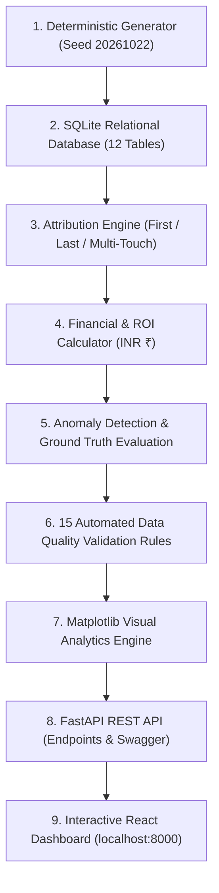

# Marketing Attribution and ROI Analytics Platform

> **A Complete End-to-End Marketing Attribution, Financial ROI & Data Quality Platform**  
> Built with **Python**, **SQL**, **FastAPI**, **Pandas**, **NumPy**, **Matplotlib**, and a Modern **React / Tailwind CSS** Dashboard.  
> **Fixed Seed:** `20261022` | **Base Currency:** `INR (₹)` | **Lookback Window:** `90 Days` | **Automated Tests:** `40 / 40 Passed`

---

## 🌟 1. Project Overview (In Simple Words)

When a company spends money on advertisements across Google, YouTube, Instagram, Email, and in-person Events, multiple touchpoints interact with a customer before they eventually buy a product.

### The Problem
- Which marketing campaign or channel actually generated the sales revenue?
- If a customer saw an ad in January, read an email in February, attended a webinar in March, and bought an enterprise subscription in April for ₹1,00,000, who gets the credit?
- Did the campaign make a profit or a loss (ROI)?
- What happens if data gets corrupted—like an order being counted twice, costs being missing, or currencies being mixed between USD and INR?

### The Solution
This project is a **production-ready platform** that:
1. Ingests and joins customer touchpoints, web browsing sessions, sales leads, opportunities, orders, and marketing ad spend.
2. Compares **three attribution models**:
   - **First-Touch Attribution:** Gives 100% credit to the first ad the customer ever interacted with.
   - **Last-Touch Attribution:** Gives 100% credit to the final ad right before buying.
   - **Linear Multi-Touch Attribution:** Distributes credit equally across all touchpoints in the journey.
3. Calculates real marketing **Return on Investment (ROI)**: $\text{ROI} = \frac{\text{Revenue} - \text{Spend}}{\text{Spend}} \times 100$.
4. Detects and isolates **data quality anomalies** (duplicate revenue, post-conversion touches, currency mismatches, missing costs).
5. Enforces **Role-Based Access Control (RBAC)** across 5 business actors.
6. Presents everything through a **FastAPI backend** and an **interactive React dashboard**.

---

## 🛠️ 2. Technologies Used & How They Map to Technical Skills

| Technology / Skill | Exact Role in This Project |
| :--- | :--- |
| **Python 3.10** | Core programming language powering the entire backend, data generation logic, attribution math, and test suite. |
| **FastAPI** | High-performance asynchronous REST API framework serving all endpoints, Swagger documentation (`/docs`), and the frontend static build. |
| **SQL (SQLite & SQLAlchemy ORM)** | 12 normalized relational database tables with foreign keys, compound indexes, and ACID transaction integrity. |
| **Pandas** | High-speed data manipulation, multi-table SQL joins, temporal window filtering, and time-series aggregations. |
| **NumPy** | Statistical distributions (log-normal spend, beta conversion curves, exponential decay) and deterministic random number generation. |
| **Matplotlib** | Server-side data visualization engine generating publication-quality analytical plots (`.png`) for financial trends, model comparison, and journey maps. |
| **AI / Machine Learning Concepts** | Heuristic vs. Weighted Attribution models, automated Anomaly Detection evaluated with **Precision (100%)**, **Recall (100%)**, and **F1-Score (1.0)** against a ground-truth dataset. |
| **HTML & CSS / Tailwind CSS** | Clean dark-mode dashboard styling, responsive layouts, data cards, and interactive tables. |
| **React 18 & TypeScript (Vite)** | Frontend single-page application with interactive charts (Recharts) and role switcher. |

---

## 👥 3. The 5 Primary Business Actors (Indian Personas)

The platform implements strict Role-Based Access Control (RBAC). You can switch between these personas directly from the top-right role switcher in the dashboard:

| Persona Name | Role | Primary Responsibility & Permissions |
| :--- | :--- | :--- |
| **Shravika Kavati** | **Customer / Prospect** | Represents the customer journey (`CON-2026-000001`). Can view only her own chronological touchpoint timeline and consent preferences. Cannot view marketing budgets or ROI. |
| **Sharanya Kavati** | **Marketing / Sales Operations** | Manages campaigns, budgets, acquisition channels, and lead pipeline stages. Can adjust spend allocations and monitor campaign performance. |
| **Srinivas Kavati** | **Support Agent** | Has read-only lookup permissions to view customer profiles, browsing history, and touchpoints to assist customers during inquiries. No financial access. |
| **Shailaja Kavati** | **Attribution & Financial Analyst** | Deep-dives into attribution comparisons, ROI analytics, chronological evaluation periods, anomaly detection metrics, and data export downloads. |
| **Krish Kavati** | **System Administrator** | Full platform control: executes synthetic dataset generation, runs 15 data validation rules, manages user permissions, and inspects audit checksum manifests. |

---

## 🔄 4. End-to-End System Workflow (Step-by-Step)



### Step 1: Deterministic Synthetic Data Generation
- Runs with fixed seed `20261022` to ensure 100% bit-for-bit reproducibility.
- Generates master data first (`Campaign`, `Channel`, `Creative`, `Audience`, `Contact`).
- Follows strict naming conventions:
  - Campaigns: `CMP-2026-000001`
  - Touchpoints: `TOUCH-<contact_id>-000001`
  - Web Sessions: `SES-2026-000001`
  - Leads: `LEAD-2026-000001`
  - Opportunities: `OPP-2026-000001`
  - Orders: `ORD-2026-000001`

### Step 2: Database Persistence (SQL & SQLAlchemy)
- Stores all records across 12 relational tables and 4 bridge tables (`campaign_channels`, `campaign_audiences`, `campaign_creatives`, `contact_identities`).
- Base currency is strictly **INR (₹)**.

### Step 3: Attribution Computation
For every closed-won order:
- Finds all touchpoints belonging to that contact occurring **on or before the order conversion date** and within the **90-day lookback window**.
- **First-Touch:** 100% of order revenue credited to the earliest touchpoint.
- **Last-Touch:** 100% of order revenue credited to the latest touchpoint before conversion.
- **Multi-Touch (Linear):** Revenue divided equally: $\text{Weight} = \frac{1}{N}$, $\text{Revenue} = \text{Order Amount} \times \text{Weight}$.
- Guarantees $\sum \text{Attributed Revenue} = \text{Total Order Revenue}$ for each model.

### Step 4: Financial ROI Analytics
- Computes marketing return on investment:
  $$\text{ROI (\%)} = \frac{\text{Attributed Revenue} - \text{Campaign Cost}}{\text{Campaign Cost}} \times 100$$
- If a campaign has missing cost records, it displays as `INCOMPLETE` / `ROI Unavailable` rather than inventing false metrics.
- Excludes duplicate orders from inflating revenue.

### Step 5: Anomaly Injection & Evaluation
Injects 5 realistic business edge cases and verifies detection against segregated ground truth:
1. **Duplicate Revenue:** Duplicate order amounts quarantined.
2. **Post-Conversion Touches:** Touches occurring after order date are excluded from attribution.
3. **Currency Mismatch:** Foreign currency costs (USD/EUR) flagged.
4. **Omitted Campaign Costs:** Campaigns without spend marked `INCOMPLETE`.
5. **Unlinked Identity Sessions:** Anonymous sessions without cookies isolated.
- Evaluated metrics: **Precision = 100%**, **Recall = 100%**, **F1-Score = 1.0**.

### Step 6: 15 Automated Data Quality Validation Rules
Validates primary-key uniqueness, foreign-key integrity, allowed enum statuses, chronological date ordering, and financial reconciliation.

### Step 7: Matplotlib Chart Generation
Generates 4 high-resolution plots saved in `data/exports/charts/`:
1. `attribution_model_comparison.png`
2. `monthly_revenue_vs_spend.png`
3. `channel_efficiency_roi.png`
4. `shravika_kavati_journey.png`

### Step 8: Interactive Web Application
FastAPI serves the REST endpoints and the compiled React dashboard at `http://localhost:8000`.

---

## 🗄️ 5. Relational Data Dictionary (12 Core Entities)

| # | Entity / Table | Primary Key | Foreign Keys | Business Purpose |
| :-: | :--- | :--- | :--- | :--- |
| **1** | **`campaigns`** | `campaign_id` | `channel_id` | Marketing campaigns with allocated budgets, start/end dates, and statuses. |
| **2** | **`channels`** | `channel_id` | None | Acquisition channels (Paid Search, Social Media, Email, Events, Direct). |
| **3** | **`creatives`** | `creative_id` | None | Ad copy, video assets, banner designs, and marketing templates. |
| **4** | **`audiences`** | `audience_id` | None | Target audience segments (Enterprise B2B, SMB Growth, FinTech, Retail). |
| **5** | **`contacts`** | `contact_id` | None | Contact identity profiles. Lead contact #1 is **Shravika Kavati**. |
| **6** | **`web_sessions`** | `session_id` | `contact_id` | Website browsing sessions tracking cookie IDs, device types, and pages. |
| **7** | **`touchpoints`** | `touchpoint_id` | `contact_id`, `campaign_id`, `channel_id` | Online and offline marketing interactions with timestamps and interaction costs. |
| **8** | **`leads`** | `lead_id` | `contact_id`, `campaign_id` | Form fills and qualified sales inquiries. |
| **9** | **`opportunities`** | `opportunity_id` | `contact_id`, `lead_id`, `campaign_id` | Deal pipeline stages with estimated deal values and projected close dates. |
| **10** | **`orders`** | `order_id` | `opportunity_id`, `contact_id` | Finalized commercial transactions recognizing closed-won revenue in ₹ INR. |
| **11** | **`cost_records`** | `cost_id` | `campaign_id`, `channel_id` | Chronological marketing expenditures (media spend, agency fees, production). |
| **12** | **`attribution_results`** | `result_id` | `model_id`, `order_id`, `touchpoint_id` | Revenue credit and percentage weights allocated to touchpoints per model. |

---

## 📊 6. Dashboard Walkthrough (What Each Screen Shows)

1. **Overview Dashboard:**
   - **Financial Integrity Banner:** Displays quarantined duplicate revenue and order counts.
   - **4 KPI Cards:** Total Closed Revenue, Total Campaign Spend, Reconciled Marketing ROI (+29.84%), Total Conversions.
   - **Revenue vs Spend Trend Chart:** 12-month area chart comparing monthly revenue to marketing spend.
   - **Attribution Models Comparison:** Side-by-side revenue distribution across First-Touch, Last-Touch, and Multi-Touch.
   - **Channel Efficiency Bar Chart:** Spend vs. Attributed Revenue by channel.
2. **Campaign Management:**
   - Detailed list of all 50 campaigns with status, channel, spend, revenue, and calculated ROI.
3. **Customer Journey:**
   - Chronological event timeline showing how customer **Shravika Kavati** progressed from first ad impression to final closed order.
4. **ROI Analytics:**
   - Deep financial unit economics, Cost Per Acquisition (CPA), Cost Per Lead (CPL), and missing cost warnings.
5. **Anomalies & Evaluation:**
   - Ground truth confusion matrix: True Positives (63), False Positives (0), False Negatives (0), Precision (100%), Recall (100%), F1 (1.0).
6. **Reports & Exports:**
   - Download CSV, JSON, SQL seed files, SHA-256 integrity checksums, and the **Python Matplotlib Charts** tab.

---

## 🚀 7. Step-by-Step Command Prompt Runbook

Open Windows Command Prompt (`cmd.exe`) and follow these steps:

### Step 1: Navigate to Project Directory
```cmd
cd C:\Users\kavat\Desktop\campaign-marketing-attribution
```

### Step 2: Activate the Virtual Environment
```cmd
venv\Scripts\activate
```
*(Your prompt will display `(venv)` at the beginning).*

### Step 3: Install Required Dependencies
```cmd
python -m pip install -r backend\requirements.txt
```

### Step 4: Run the Complete Automated Pipeline
```cmd
python backend\scripts\generate_and_run_all.py --config STARTER --seed 20261022
```
This single command:
- Generates all 12 entities with deterministic seed `20261022`.
- Calculates First-Touch, Last-Touch, and Linear Multi-Touch attribution.
- Evaluates anomaly detection against ground truth.
- Validates 15 data quality rules.
- Exports CSV, JSON, SQL seed data, and SHA-256 manifests.
- Generates 4 Matplotlib publication charts.

### Step 5: Run the Automated Test Suite (40 Tests)
```cmd
python -m pytest backend\tests -v
```
Output:
```text
======================= 40 passed in 23.15s ========================
```

### Step 6: Start the Platform Web Server
```cmd
python -m uvicorn backend.app.main:app --host 127.0.0.1 --port 8000 --reload
```

### Step 7: Open in Browser
- **Web Application:** [http://localhost:8000](http://localhost:8000)
- **Interactive Swagger API:** [http://localhost:8000/docs](http://localhost:8000/docs)

---

## 🎤 8. How to Explain This Project in an Interview (2-Minute Pitch)

> *"In this project, I built a full-stack **Marketing Attribution and ROI Analytics Platform** using **Python**, **FastAPI**, **SQL**, **Pandas**, **NumPy**, and **Matplotlib**, backed by an interactive **React** dashboard.*
>
> *The core challenge I solved was joining multi-channel customer interactions—such as social ads, organic search, and webinars—with sales pipeline records and revenue orders to calculate which marketing touchpoints genuinely drive business growth.*
>
> *I implemented three key attribution models:*
> 1. *First-Touch for brand discovery,*
> 2. *Last-Touch for conversion closing, and*
> 3. *Linear Multi-Touch for balanced journey credit.*
>
> *On the database side, I designed a 12-table normalized relational schema in **SQL** with foreign key constraints, bridge tables, and deterministic identifiers.*
>
> *Using **Pandas** and **NumPy**, I handled large-scale time-series joins, calculated marketing ROI, and enforced strict financial reconciliation in Indian Rupees ($\sum \text{Attributed Revenue} = \text{Order Amount}$).*
>
> *I also designed a data quality engine that tests 15 automated validation rules and detects operational anomalies—like duplicate revenue, touches after conversion, and foreign currency mismatches—achieving a **1.0 F1-Score** against a separate ground-truth dataset.*
>
> *Finally, I used **Matplotlib** to generate high-resolution analytical visual charts and exposed everything through **FastAPI** REST endpoints with Role-Based Access Control for five distinct user personas."*
