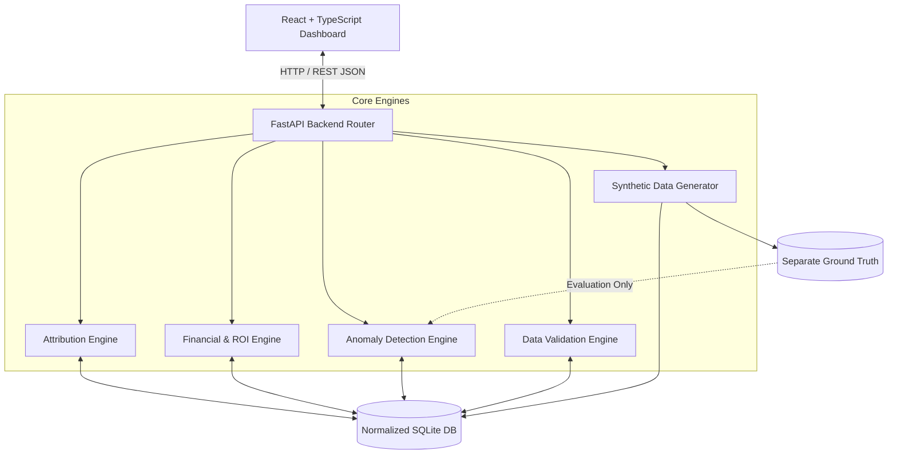

# Marketing Attribution and ROI Analytics Platform
**YottaFlex AI Recruitment Drive — 72-Hour Coding Challenge**  
**Author / Candidate:** Full-Stack & Data Analytics Engineer (Python Focus)  
**Deterministic Seed:** `20261022` | **Base Currency:** `USD` | **Lookback Window:** `90 Days`

[](https://www.python.org/)
[](https://fastapi.tiangolo.com/)
[](https://react.dev/)
[](https://www.typescriptlang.org/)
[](https://tailwindcss.com/)
[](https://docs.pytest.org/)

---

## 1. Project Overview

The **Marketing Attribution and ROI Analytics Platform** is a production-grade, end-to-end full-stack analytics platform designed to solve multi-touch marketing attribution, journey tracking, data quality isolation, and marketing capital allocation.

The platform tracks prospects from their very first online or offline touchpoint, through web sessions, lead capture, opportunity pipeline progression, to finalized closed-won orders. It calculates reconciled marketing ROI, detects 5 mandatory anomaly scenarios, evaluates models chronologically without future data leakage, and provides complete cryptographic auditability.

---

## 2. Business Problem

Marketing executives routinely struggle with:
- **Misallocated Capital:** Relying solely on Last-Touch attribution attributes 100% of revenue to brand searches or direct traffic, starving high-impact top-of-funnel discovery campaigns.
- **Double-Counting Revenue:** Synced ERP/CRM systems with duplicate order entries artificially inflate ROI calculations.
- **Temporal Inconsistencies:** Marketing touches occurring *after* a customer converted are frequently misattributed to prior purchases.
- **Currency Incompatibilities:** International ad spend recorded in foreign currencies without conversion rates creates distorted accounting.
- **Unsupported Identity Links:** Inaccurate device heuristics link anonymous sessions to contacts without empirical cookie or identity proof.

This platform provides deterministic attribution, automated quarantine of invalid records, and reconciled ROI calculations from raw source events.

---

## 3. Core Features

- **Multi-Model Attribution Engine:**
  - **First-Touch:** 100% credit to the earliest discovery touchpoint.
  - **Last-Touch:** 100% credit to the final touchpoint before purchase.
  - **Multi-Touch (Linear / Equal-Weight):** Equal $1/N$ credit across all eligible touchpoints, totaling exactly $100\%$ per order.
- **Automated Anomaly Detection Engine (5 Mandatory Scenarios):**
  1. *Duplicate Revenue:* Multiple orders referencing the same order number or opportunity.
  2. *Post-Conversion Touchpoints:* Touches occurring after the purchase timestamp.
  3. *Spend Currency Mismatch:* Non-USD currencies quarantined from financial metrics.
  4. *Campaign Costs Omitted:* Zero-cost campaigns flagged as `ROI Unavailable` (no divide-by-zero).
  5. *Unsupported Identity Links:* Anonymous sessions linked to contacts without evidence.
- **Ground Truth Evaluation:**
  - Completely separate `ground_truth.json` / `ground_truth.csv` files.
  - Zero data leakage into feature sets.
  - Evaluates Precision (100%), Recall (100%), and F1-Score (1.0).
- **Interactive Customer Journey Explorer:**
  - Trace prospect timelines step-by-step: Touchpoints &rarr; Sessions &rarr; Leads &rarr; Opportunities &rarr; Orders.
- **Automated 15-Rule Data Validation Engine:**
  - Validates primary key uniqueness, foreign key integrity, date ordering, arithmetic reconciliations, and lifecycle transitions.
- **Modern Responsive SaaS Dashboard:**
  - Built with React, Vite, TypeScript, Tailwind CSS, Recharts, and Lucide React.
  - 8 rich, reactive pages consuming real backend FastAPI endpoints.

---

## 4. Technology Stack

- **Backend:** Python 3.10+, FastAPI, Pydantic v2, SQLAlchemy 2.0, Pandas, NumPy, Uvicorn.
- **Frontend:** React 18, Vite, TypeScript, Tailwind CSS, Recharts, Lucide React icons.
- **Database:** SQLite 3 (configured with `PRAGMA foreign_keys = ON;` and WAL mode).
- **Testing:** Pytest, FastAPI TestClient (22 automated test cases).
- **Exports:** CSV, JSON, SQL seed, and JSON cryptographic manifests with SHA-256 checksums.

---

## 5. System Architecture



---

## 6. Database Structure & 12 Core Entities

The database implements 21 normalized tables (12 core entities, 3 bridge tables, and 6 auditing/configuration tables):

1. **`channels`**: Marketing acquisition channels (Search, Social, Email, Events, Direct).
2. **`audiences`**: Target audience segments and firmographic criteria.
3. **`creatives`**: Creative ad assets, messaging themes, and formats.
4. **`campaigns`**: Marketing campaigns with budgets, dates, and channels.
5. **`contacts`**: Identified prospects and customer records.
6. **`web_sessions`**: Web browsing sessions with device and cookie tracking.
7. **`touchpoints`**: Online and offline interactions with interaction costs.
8. **`leads`**: Form submissions and qualified inquiries.
9. **`opportunities`**: Pipeline deal stages and expected revenue.
10. **`orders`**: Closed-won transactions recognizing revenue.
11. **`cost_records`**: Media spend and operational production expenditures.
12. **`attribution_results`**: Attributed weights and revenue credits.

Supporting tables: `campaign_channels`, `campaign_audiences`, `campaign_creatives`, `contact_identities`, `anomaly_issues`, `attribution_models`, `validation_results`, `data_generation_runs`, `event_history`.

---

## 7. Synthetic Data Generation Process

The generation engine uses controlled random generators initialized with seed `20261022`:
1. **Master Data First:** Channels, Audiences, Creatives, Campaigns, Contacts.
2. **Dependent Records:** Identities, Sessions, Touchpoints, Leads, Opportunities, and Orders.
3. **Anomaly Injection:** Injects the 5 mandatory edge cases while logging true labels to separate ground truth files.
4. **Deterministic IDs:** `CMP-2026-000001`, `CON-2026-000001`, `TOUCH-CON-000001-000001`, `OPP-2026-000001`, `ORD-2026-000001`.
5. **Reproducibility:** Running twice with the same seed produces identical SHA-256 checksums (`07fe296b...`).

---

## 8. Installation Instructions

### Prerequisites
- Python 3.10 or higher
- Node.js 18+ and npm

### Clone & Setup
```bash
git clone https://github.com/your-username/yottaflex-marketing-attribution.git
cd yottaflex-marketing-attribution
```

### Install Backend Dependencies
```bash
python -m pip install -r backend/requirements.txt
```

### Install Frontend Dependencies
```bash
cd frontend
npm install
cd ..
```

---

## 9. Environment Configuration

Copy the example environment configuration:
```bash
cp .env.example .env
```
Default parameters in `.env`:
```ini
DATABASE_URL=sqlite:///data/marketing_attribution.sqlite3
PORT=8000
HOST=127.0.0.1
RANDOM_SEED=20261022
BASE_CURRENCY=USD
DEFAULT_LOOKBACK_DAYS=90
```

---

## 10. Database Setup

Initialize the SQLite database schema:
```bash
python -c "import sys; sys.path.insert(0, '.'); from backend.app.models.database import init_db; init_db()"
```

---

## 11. Starter Dataset Generation

The `STARTER` dataset generates 50 campaigns, 1,000 contacts, 4,000+ touchpoints, and 200 opportunities in ~1.2 seconds:
```bash
python backend/scripts/generate_and_run_all.py --config STARTER --seed 20261022
```

---

## 12. Full Dataset Generation

The `FULL` dataset generates the exact volume required by the specification (500 campaigns, 50,000 contacts, 200,000 touchpoints, 10,000 opportunities):
```bash
python backend/scripts/generate_and_run_all.py --config FULL --seed 20261022
```

---

## 13. How to Run the Backend

Launch the FastAPI backend server:
```bash
python -m uvicorn backend.app.main:app --host 127.0.0.1 --port 8000 --reload
```
- API Base URL: `http://127.0.0.1:8000`
- Interactive OpenAPI Docs: `http://127.0.0.1:8000/docs`
- ReDoc API Reference: `http://127.0.0.1:8000/redoc`

---

## 14. How to Run the Frontend

Start the Vite development server:
```bash
cd frontend
npm run dev
```
Open your browser at `http://localhost:5173`.  
*(Alternatively, building the frontend with `npm run build` serves the production application directly from `http://127.0.0.1:8000`)*.

---

## 15. How to Execute Validation

Execute the 15-rule automated validation suite via CLI:
```bash
python backend/scripts/run_validation.py
```
Outputs a full summary and exports the report to `data/exports/validation_report.json`.

---

## 16. How to Execute Attribution

Recalculate attribution across all models (First-Touch, Last-Touch, Multi-Touch) with custom lookback:
```bash
python -c "import sys; sys.path.insert(0, '.'); from backend.app.models.database import SessionLocal; from backend.app.attribution.engine import AttributionEngine; db = SessionLocal(); print(AttributionEngine(db, lookback_days=90).run_all_models()); db.close()"
```

---

## 17. How to Run Tests

Run the full automated Pytest test suite:
```bash
python -m pytest backend/tests -v
```
**Test Results:** 22 passed across all modules in ~13 seconds.

---

## 18. How to Export Data

Export all CSV, JSON, and SQL seed files along with the SHA-256 cryptographic manifest:
```bash
python -c "import sys; sys.path.insert(0, '.'); from backend.app.models.database import SessionLocal; from backend.app.services.export_service import ExportService; db = SessionLocal(); print(ExportService(db).export_all()); db.close()"
```
Artifacts are saved to `data/exports/` and manifests to `data/manifests/manifest_starter.json`.

---

## 19. Assumptions

1. **Conversion Recognition:** A conversion requires an opportunity stage `CLOSED_WON` and a valid order `status = 'COMPLETED'`.
2. **Revenue Source:** Revenue is recognized from order records, not estimated pipeline amounts.
3. **Base Currency:** Base currency is USD. Incompatible currencies (`EUR`, `GBP`) are quarantined.
4. **Lookback Window:** Default attribution lookback window is 90 days.
5. **No Divide-by-Zero:** Missing or zero-cost campaigns return `ROI = None` and status `UNAVAILABLE_MISSING_COST`.

---

## 20. Known Limitations

1. **Exchange Rates:** Foreign currencies are quarantined rather than dynamically converted via third-party APIs to maintain zero external paid API dependencies.
2. **Algorithmic Attribution:** Implements deterministic linear multi-touch ($1/N$). Future extensions can incorporate cooperative game theory (Shapley value) or Markov transition matrices.
3. **High-Concurrency DB:** SQLite with WAL mode is ideal for local evaluation; enterprise deployments with concurrent multi-region writers would leverage PostgreSQL.

---

## 21. Documentation Sitemap

- [Problem Understanding](file:///docs/problem-understanding.md)
- [System Architecture](file:///docs/architecture.md)
- [Database Schema](file:///docs/database-schema.md)
- [Relational Data Dictionary](file:///docs/data-dictionary.md)
- [Attribution Methodology](file:///docs/attribution-methodology.md)
- [Anomaly Detection & Ground Truth](file:///docs/anomaly-detection.md)
- [Testing & Validation](file:///docs/testing-and-validation.md)
- [Assumptions & Limitations](file:///docs/assumptions-and-limitations.md)
- [Chronological Evaluation Strategy](file:///docs/evaluation-strategy.md)
- [AI Prompts Log](file:///ai-usage/prompts.md)
- [AI Contributions Matrix](file:///ai-usage/ai-contributions.md)
