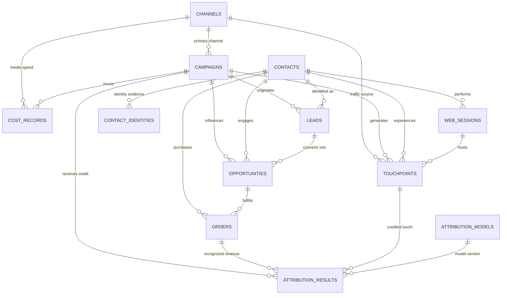

# Database Schema Documentation
**Database Engine:** SQLite 3  
**Integrity Mode:** `PRAGMA foreign_keys = ON;`, `PRAGMA journal_mode = WAL;`

---

## 1. Entity Relationship Overview

The database contains 21 normalized tables comprising 12 core business entities, 3 many-to-many bridge tables, and 6 auditing/configuration tables.

---

## 2. Table Specifications & Cardinalities

### 1. `channels`
- **PK:** `channel_id` VARCHAR(50)
- **Fields:** `name` VARCHAR(100) UNIQUE, `channel_type` VARCHAR(20) [ONLINE, OFFLINE], `cost_structure` VARCHAR(20) [CPC, CPM, FLAT, COMMISSION], `is_active` BOOLEAN, `created_at` DATETIME.
- **Cardinality:** 1:N with `campaigns`, `touchpoints`, `cost_records`.

### 2. `audiences`
- **PK:** `audience_id` VARCHAR(50)
- **Fields:** `name` VARCHAR(100), `segment_type` VARCHAR(50), `target_criteria` TEXT, `created_at` DATETIME.
- **Cardinality:** N:M with `campaigns` via `campaign_audiences`.

### 3. `creatives`
- **PK:** `creative_id` VARCHAR(50)
- **Fields:** `name` VARCHAR(100), `creative_format` VARCHAR(50) [BANNER, VIDEO, TEXT_AD, etc.], `asset_url` VARCHAR(255), `message_theme` VARCHAR(100), `created_at` DATETIME.
- **Cardinality:** N:M with `campaigns` via `campaign_creatives`; 1:N with `touchpoints`.

### 4. `campaigns`
- **PK:** `campaign_id` VARCHAR(50)
- **FK:** `channel_id` &rarr; `channels.channel_id`
- **Fields:** `name` VARCHAR(150), `budget` FLOAT, `currency` VARCHAR(10) [USD], `status` VARCHAR(20) [ACTIVE, COMPLETED], `start_date` DATETIME, `end_date` DATETIME, `created_at` DATETIME, `updated_at` DATETIME.
- **Cardinality:** 1:N with `leads`, `opportunities`, `cost_records`, `touchpoints`, `attribution_results`.

### 5. `contacts`
- **PK:** `contact_id` VARCHAR(50)
- **Fields:** `first_name` VARCHAR(100), `last_name` VARCHAR(100), `email` VARCHAR(150) UNIQUE, `phone` VARCHAR(50), `lifecycle_stage` VARCHAR(30) [SUBSCRIBER, LEAD, CUSTOMER], `first_seen_at` DATETIME, `created_at` DATETIME.
- **Cardinality:** 1:N with `contact_identities`, `web_sessions`, `touchpoints`, `leads`, `opportunities`, `orders`.

### 6. `web_sessions`
- **PK:** `session_id` VARCHAR(50)
- **FK:** `contact_id` &rarr; `contacts.contact_id` (nullable for anonymous sessions)
- **Fields:** `anonymous_cookie_id` VARCHAR(100), `started_at` DATETIME, `ended_at` DATETIME, `device_type` VARCHAR(30), `landing_page` VARCHAR(255), `referrer` VARCHAR(255), `is_authenticated` BOOLEAN, `created_at` DATETIME.
- **Cardinality:** 1:N with `touchpoints`.

### 7. `touchpoints`
- **PK:** `touchpoint_id` VARCHAR(100)
- **FKs:** `contact_id`, `campaign_id`, `channel_id`, `creative_id`, `session_id`
- **Fields:** `touch_type` VARCHAR(30), `channel_medium` VARCHAR(20) [ONLINE, OFFLINE], `occurred_at` DATETIME, `interaction_cost` FLOAT, `created_at` DATETIME.
- **Cardinality:** 1:N with `attribution_results`.

### 8. `leads`
- **PK:** `lead_id` VARCHAR(50)
- **FKs:** `contact_id`, `campaign_id`
- **Fields:** `lead_source` VARCHAR(50), `status` VARCHAR(30) [NEW, QUALIFIED], `created_at` DATETIME.
- **Cardinality:** 1:N with `opportunities`.

### 9. `opportunities`
- **PK:** `opportunity_id` VARCHAR(50)
- **FKs:** `contact_id`, `lead_id`, `campaign_id`
- **Fields:** `stage` VARCHAR(30) [PROSPECTING, QUALIFICATION, PROPOSAL, CLOSED_WON, CLOSED_LOST], `expected_revenue` FLOAT, `close_date` DATETIME, `created_at` DATETIME, `updated_at` DATETIME.
- **Cardinality:** 1:N with `orders`.

### 10. `orders`
- **PK:** `order_id` VARCHAR(50)
- **FKs:** `opportunity_id`, `contact_id`
- **Fields:** `order_number` VARCHAR(50), `order_date` DATETIME, `amount` FLOAT, `currency` VARCHAR(10) [USD], `status` VARCHAR(30) [COMPLETED], `is_duplicate_flag` BOOLEAN, `created_at` DATETIME.
- **Cardinality:** 1:N with `attribution_results`.

### 11. `cost_records`
- **PK:** `cost_id` VARCHAR(50)
- **FKs:** `campaign_id`, `channel_id`
- **Fields:** `recorded_date` DATETIME, `amount` FLOAT, `currency` VARCHAR(10) [USD, EUR, GBP], `cost_type` VARCHAR(30), `created_at` DATETIME.

### 12. `attribution_results`
- **PK:** `result_id` VARCHAR(50)
- **FKs:** `model_id`, `opportunity_id`, `order_id`, `campaign_id`, `channel_id`, `touchpoint_id`
- **Fields:** `attribution_weight` FLOAT, `attributed_revenue` FLOAT, `touchpoint_timestamp` DATETIME, `conversion_timestamp` DATETIME, `evaluation_period` VARCHAR(20) [TRAIN, VALIDATION, TEST], `created_at` DATETIME.

---

## 3. Bridge and Auditing Tables

- **`campaign_channels`:** Composite PK `(campaign_id, channel_id)`, `is_primary` BOOLEAN.
- **`campaign_audiences`:** Composite PK `(campaign_id, audience_id)`.
- **`campaign_creatives`:** Composite PK `(campaign_id, creative_id)`.
- **`contact_identities`:** PK `identity_id`, FK `contact_id`, `identity_type` (COOKIE, EMAIL_HASH, DEVICE_ID), `identity_value`, `evidence_source`, `first_observed_at`.
- **`anomaly_issues`:** PK `issue_id`, `entity_type`, `entity_id`, `issue_type`, `severity`, `description`, `expected_decision`, `actual_decision`, `resolution_status`, `related_record_ids`.
- **`attribution_models`:** PK `model_id`, `model_code`, `name`, `description`, `lookback_window_days`, `version`, `is_active`.
- **`validation_results`:** PK `validation_id`, `run_timestamp`, `rule_code`, `rule_name`, `status`, `records_checked`, `records_passed`, `records_failed`, `details_json`.
- **`data_generation_runs`:** PK `run_id`, `config_name`, `seed`, `status`, `row_counts_json`, `checksums_json`, `started_at`, `completed_at`.
- **`event_history`:** PK `history_id`, `entity_name`, `entity_id`, `event_type`, `old_state`, `new_state`, `timestamp`, `details_json`.
