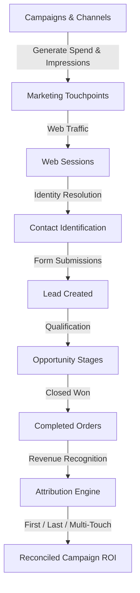

# Problem Understanding & Business Context
**Project:** Marketing Attribution and ROI Analytics Platform  
**Client / Challenge:** YottaFlex AI Recruitment Drive  
**Domain:** Multi-Touch Marketing Attribution, B2B/B2C Customer Journey Tracking, Unit Economics & ROI Analytics

---

## 1. Executive Summary

Modern enterprise marketing relies on multiple digital and offline channels—Paid Search, Organic SEO, Social Media, Email Marketing, Display Ads, Webinars, Events, and Direct Outreach. Prospects interact across numerous touchpoints and multiple devices before eventually submitting a lead form, advancing through opportunity stages, and completing a purchase.

Without a robust attribution platform, marketing teams face critical challenges:
1. **Misallocated Capital:** Relying solely on Last-Touch attribution credits the final click (often direct or brand search) while ignoring top-of-funnel discovery campaigns that initially generated awareness.
2. **Double-Counting Revenue:** Order records duplicated across sync systems or opportunities artificially inflate perceived marketing ROI.
3. **Temporal Inconsistencies:** Marketing touchpoints occurring *after* a purchase are frequently misattributed to prior conversions.
4. **Currency Incompatibilities:** Multinational campaigns recording expenses in multiple currencies without exchange rate standardization distort financial metrics.
5. **Phantom Attribution:** Linking anonymous browsing sessions to identified contacts without cryptographic or cookie evidence produces unverified attribution claims.

---

## 2. Business Workflow & Entity Lifecycle

### Primary Actors & Use Cases
- **Customer / Prospect:** Interacts with marketing campaigns, generates touchpoints, visits the website, submits inquiries, and converts.
- **Marketing & Sales Operations:** Creates campaigns, allocates budgets, manages channels, tracks leads, and evaluates pipeline velocity.
- **Support & Audit Agent:** Investigates journey inconsistencies, reviews missing identity links, and inspects quarantined anomaly records.
- **Data & Financial Analyst:** Compares attribution models (First-Touch, Last-Touch, Multi-Touch), evaluates unit economics (CPL, CPA, ROI), and verifies revenue reconciliation.
- **System Administrator:** Controls deterministic data generation runs, executes automated validation suites, and monitors system health.

---

## 3. Core Objectives

1. **Deterministic Traceability:** Every dollar of attributed revenue must trace back through a verified order, closed-won opportunity, lead, and eligible touchpoint to a specific campaign.
2. **Model Comparison:** Provide side-by-side comparative analysis of:
   - First-Touch Attribution ($w = 1.0$)
   - Last-Touch Attribution ($w = 1.0$)
   - Multi-Touch Attribution ($w = 1/N$, summing to $1.0 \pm 10^{-6}$)
3. **Automated Anomaly Detection:** Detect 5 mandatory edge-case exceptions independently of ground truth labels and maintain an immutable quarantine log.
4. **Reproducibility:** Fixed seed (`20261022`) guarantees byte-for-byte identical output datasets, record counts, and SHA-256 checksums across independent execution runs.
